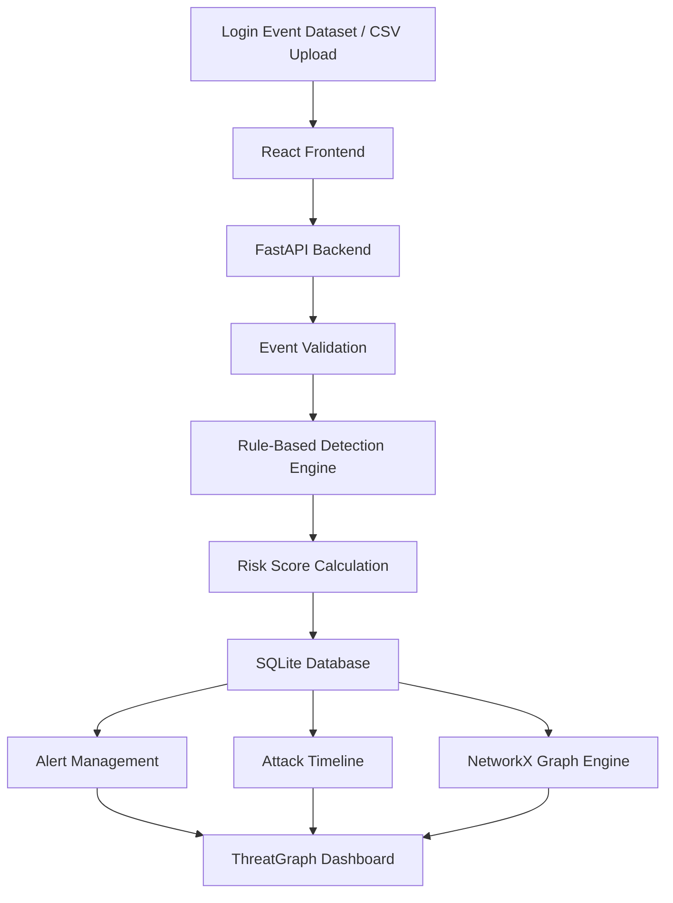

# 🛡️ ThreatGraph
### Explainable Cyberattack Detection & Investigation System

<p align="center">
  <strong>Detect suspicious activity. Visualize attack relationships. Investigate threats.</strong>
</p>

<p align="center">
  <a href="https://threatgraph.firebaseapp.com/">
    
  </a>
  <a href="https://drive.google.com/file/d/1AO9z8whPXFfAW4_g3CWTynTilFVvCXKT/view">
    
  </a>
</p>

<p align="center">
  
  
  
  
  
  
</p>

---

## 🚀 Overview

**ThreatGraph** is an explainable cybersecurity monitoring and investigation platform designed to identify suspicious login activities, assess potential security threats, and visualize relationships between user accounts and IP addresses.

Instead of simply flagging suspicious events, ThreatGraph uses a **rule-based risk scoring engine** to explain why an activity is considered risky. Security analysts can monitor alerts, examine attack patterns, investigate incidents, and explore relationships through an interactive graph.

Built as part of the **KALPAK 2K26 – Campus Cup 4-Hour Hackathon**, ThreatGraph was developed and deployed within a strict four-hour timeframe.

## 🌐 Explore the Project

| Resource | Link |
|---|---|
| 🚀 Live Application | [threatgraph.web.app](https://threatgraph.web.app/) |
| 🎬 Video Demonstration | [Watch Project Demo](https://lnkd.in/dsh9xmqk) |
| ⚙️ Backend API | [ThreatGraph API](https://threatgraph-backend.onrender.com/) |
| 📖 API Documentation | [Swagger UI](https://threatgraph-backend.onrender.com/docs) |

---

## 📸 Application Preview

### 1. Attack Relationship Graph

Visualize connections between user accounts and IP addresses to identify potentially related suspicious activities.


### 2. Attack Timeline

Explore security incidents chronologically and inspect their associated risk levels and detection reasons.


### 3. Investigation Details

Examine individual incidents, understand risk scores, review triggered detection rules, and view recommended responses.


### 4. Security Alerts

Search, filter, sort, and review suspicious events based on severity, risk level, and review status.


---

##  Key Features

### 🔍 Suspicious Login Detection
- Detect repeated failed login attempts.
- Identify unusual login times.
- Flag unfamiliar IP addresses.
- Detect successful logins following repeated failures.

### 📊 Explainable Risk Scoring
- Assign risk scores based on triggered detection rules.
- Display individual rule contributions.
- Classify incidents into risk categories.
- Explain why an event was flagged.

### 🕸️ Interactive Attack Relationship Graph
- Visualize user accounts and IP addresses.
- Explore relationships between entities.
- Identify potentially shared infrastructure.
- Filter high-risk nodes.
- Select nodes to inspect additional information.

### ⏱️ Attack Timeline
- View incidents chronologically.
- Identify suspicious activity patterns.
- Inspect individual incident details.

### 🚨 Security Alert Management
- Search alerts by user, IP, reason, or status.
- Filter alerts by risk level.
- Sort incidents by timestamp.
- Update review status.

### 🔬 Investigation Dashboard
- Examine individual security incidents.
- View backend-calculated risk scores.
- Understand detection explanations.
- Access recommended administrative responses.

### 📂 CSV Event Ingestion
- Upload login event datasets.
- Validate incoming CSV files.
- Process multiple login records.
- Generate alerts using the same detection engine.

---

## 🧠 Risk Scoring Engine

ThreatGraph uses a transparent, rule-based scoring mechanism to calculate suspicious activity risk.

| Detection Rule | Risk Points |
|---|---:|
| 5–9 failed login attempts | +15 |
| 10 or more failed login attempts | +30 |
| Unusual login time | +15 |
| Unfamiliar IP address | +20 |
| Successful login after failures | +15 |

The final score is capped at 100.

### Risk Classification

| Risk Score | Classification |
|---|---|
| 0–29 | 🟢 Low |
| 30–59 | 🟡 Medium |
| 60–79 | 🟠 High |
| 80–100 | 🔴 Critical |

Each flagged event includes an explanation of the rules that contributed to its score.

> **Note:** ThreatGraph's current detection engine is rule-based. It does not claim to use a trained machine learning model.

---

## 🏗️ System Architecture



### Technology Stack

| Layer | Technology |
|---|---|
| Frontend | React.js, Vite |
| Backend | Python, FastAPI |
| Database | SQLite |
| Graph Analysis | NetworkX |
| API Communication | REST API |
| Frontend Hosting | Firebase Hosting |
| Backend Hosting | Render |
| Version Control | Git & GitHub |

---

## 📁 Project Structure

```text
ThreatGraph/
│
├── backend/
│   ├── main.py
│   ├── graph_engine.py
│   ├── requirements.txt
│   └── ...
│
├── frontend/
│   ├── src/
│   │   ├── pages/
│   │   ├── components/
│   │   ├── api.js
│   │   └── ...
│   ├── package.json
│   └── ...
│
├── docs/
│   └── screenshots/
│       ├── attack-graph.png
│       ├── attack-timeline.png
│       ├── investigation-details.png
│       └── security-alerts.png
│
└── README.md
```

---

## ⚙️ Run Locally

### Prerequisites

- Python 3.x
- Node.js and npm
- Git

### 1. Clone the Repository

```bash
git clone https://github.com/mariyashaikh-crypto/ThreatGraph.git
cd ThreatGraph
```

### 2. Set Up the Backend

```bash
cd backend

python -m venv venv
```

Activate the virtual environment:

**Windows:**
```bash
venv\Scripts\activate
```

Install dependencies:

```bash
pip install -r requirements.txt
```

Start the backend:

```bash
uvicorn main:app --reload
```

Backend runs at:

`http://127.0.0.1:8000`

API documentation:

`http://127.0.0.1:8000/docs`

### 3. Set Up the Frontend

Open another terminal:

```bash
cd frontend
npm install
npm run dev
```

Open the local frontend URL displayed in your terminal.

> For local development, configure the frontend API base URL to point to your local FastAPI server.

---

## ☁️ Deployment

ThreatGraph is deployed using:

| Component | Platform |
|---|---|
| Frontend | [Firebase Hosting](https://firebase.google.com/products/hosting) |
| Backend | [Render](https://render.com/) |
| Database | SQLite |

**Live application:** https://threatgraph.web.app/

**Backend:** https://threatgraph-backend.onrender.com/

---

## 🔮 Future Enhancements

- Real-time login event monitoring.
- Advanced anomaly detection.
- Integration with additional security data sources.
- Enhanced graph-based threat correlation.
- More detailed incident investigation workflows.
- Authentication and role-based analyst access.

---

## ⚠️ Disclaimer

ThreatGraph is an educational cybersecurity prototype developed for hackathon purposes. It uses rule-based detection and sample login event data. Its alerts and recommendations are intended for demonstration and investigation support, not as a replacement for production-grade security monitoring systems.

---
